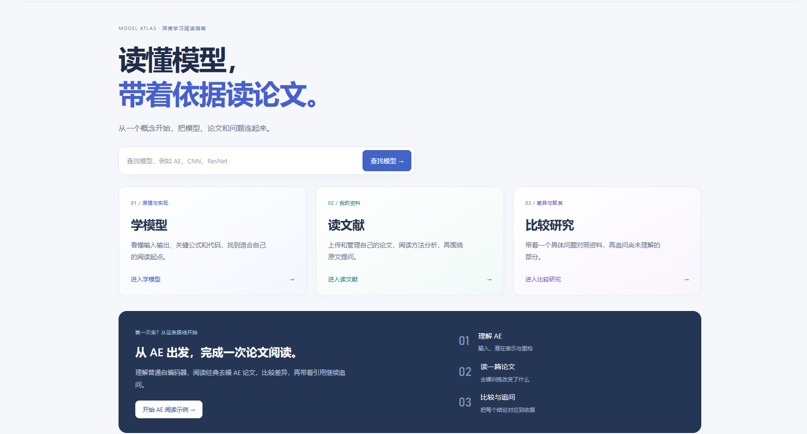
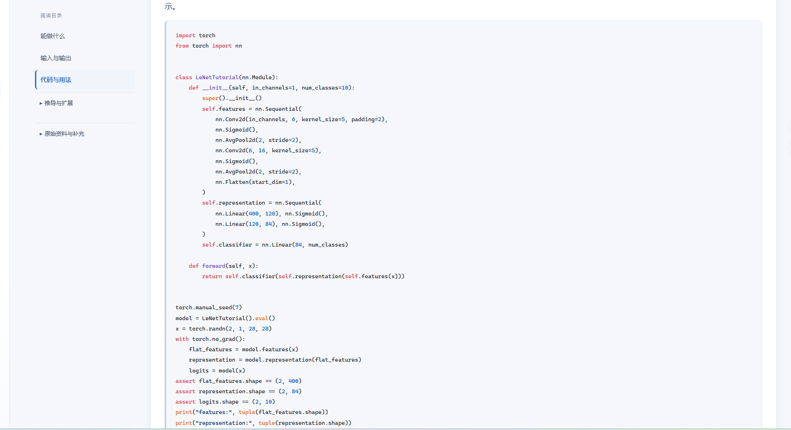
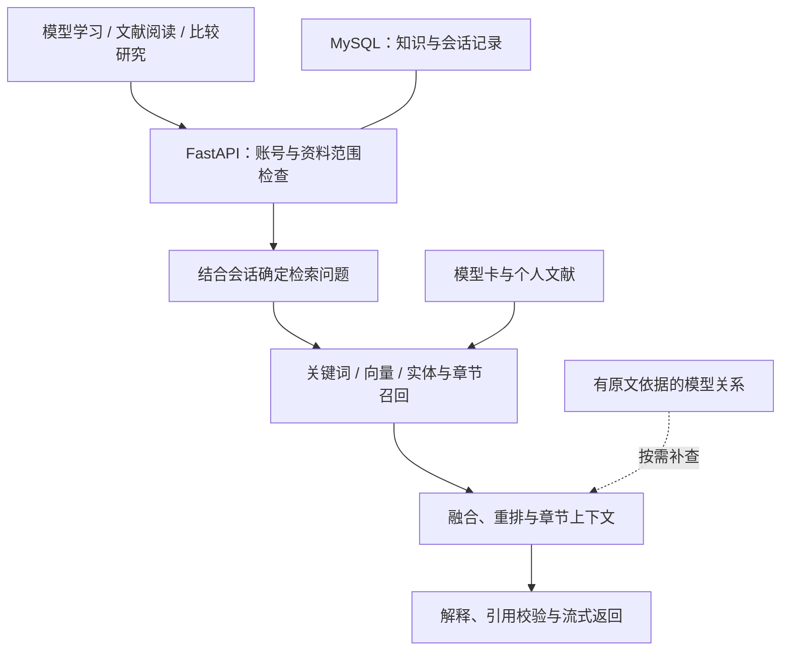

<h1 align="center">Model Atlas · 深度学习模型知识库</h1>

<p align="center"><strong>从理解一个模型，到读懂一篇论文，再到核对不同方法之间的联系。</strong></p>
<p align="center">FastAPI × LangGraph × 混合检索 · 模型学习、论文阅读与跨资料查证</p>

<p align="center">
  
  
  
  
  
</p>

Model Atlas 将模型学习、个人文献和带引用的问答连接在同一工作空间。可以查看模型的输入输出、结构、公式与代码，导入论文并生成阅读报告，再围绕具体资料比较方法、连续追问和查证来源。

[项目快照](#screenshots) · [快速开始](#quickstart) · [使用流程](docs/USAGE.md) · [系统架构](docs/ARCHITECTURE.md) · [测试说明](docs/TESTING.md)

<a id="screenshots"></a>

## 📷 项目快照

<p align="center">
  <a href="docs/assets/screenshots/home.png"></a>
</p>

<p align="center"><sub>首页：从模型学习进入文献阅读，再通过比较与追问核对依据。</sub></p>

<details>
<summary><strong>展开查看模型阅读与代码示例</strong></summary>

<p align="center">
  <a href="docs/assets/screenshots/model-code.png"></a>
</p>

<p align="center"><sub>模型阅读局部示例：CNN 教学代码、张量形状检查与章节导航。点击图片可查看原尺寸。</sub></p>

</details>

## ✨ 可以用它完成什么

| 入口 | 适合的需求 | 获得的内容 |
| --- | --- | --- |
| **学模型** | 先理解模型，再阅读相关研究 | 原理、输入输出、公式解释、教学代码与来源；可围绕当前章节提问 |
| **我的文献** | 管理和阅读自己上传的论文 | 解析后的章节定位、整篇分析报告、主题标签及待确认的关系 |
| **比较研究** | 对比多个模型或不同文献中的方法 | 按比较维度查找资料，围绕证据缺口补查，返回带引用的比较结果 |

智能问答贯穿三个入口。同一会话保留已提交的交流记录，提问可以关联当前模型、章节和所选文献；回答中的引用用于回到相应资料核对。

## 🧭 一条完整的使用过程

以阅读一篇使用自编码器的论文为例：


| 步骤 | 用户操作 | 平台提供的支持 |
| --- | --- | --- |
| 理解模型 | 打开 Autoencoder，查看输入、潜在表示和重构输出 | 将公式、张量形状和教学实现放在对应章节中阅读 |
| 阅读论文 | 上传一篇实际讨论 AE 方法的文献 | 后台解析与切分，获得云端处理许可后生成阅读报告 |
| 比较方法 | 询问“论文改变了网络结构、训练目标，还是输入处理？” | 根据可用正文分别查找依据，组织比较结果和引用 |
| 连续查证 | 追问“这个结论来自论文实验，还是一般原理？” | 结合会话理解问题，区分论文记载、整理说明和条件推导 |

解释以导入资料和本轮正文为依据，论文中的实际设置与通用模型知识分别呈现。

## 🧩 核心能力

### 模型学习：把概念、公式和代码放到一起

- 按概览、输入输出、公式、代码、模型关系等章节组织内容。
- 公式使用数学排版，代码提供语法高亮，并结合张量形状说明数据流。
- 区分教学实现与论文中的实际模型配置，保留论文、官方文档和实现入口。
- 随仓库提供 16 张整理模型卡，涉及卷积网络、自编码器、序列模型、Transformer 和多模态模型等方向。

教学代码用于解释结构与接口，RAG 服务不执行这些代码，也不负责训练论文模型。[查看资料来源](模型知识库资料/首批资料清单.md)

### 文献阅读：从上传文件到可查证的阅读报告

支持导入 PDF、Markdown 和文本。切片在后台完成，前台围绕整篇资料展示主题、研究方法、创新点及依据，标签和关系在确认后进入知识管理流程。

“我的文献”只列出当前账号的资料，支持按标题、文件名和标签查找；文献版本与检索优先级可以单独管理。公共模型资料通过模型内容和回答引用查看。[查看导入与阅读流程](docs/USAGE.md#导入与阅读文献)

### 资料问答：连续提问，并保留可核对的出处

问题可结合当前模型、章节、所选文献和近期会话确定对象。回答通过 SSE 返回，引用对应本轮实际提供的正文，提供文档、章节、页码及解析段落等可用定位信息。

处理所选文献时，可以限定只依据本文，或允许在资料不足时补查获准处理的知识。补充资料用于解释一般机制，不能证明原论文采用了同样的实现。[查看问答与资料范围](docs/USAGE.md#连续提问与资料范围)

### 模型关系：沿有依据的联系继续查找

模型、模块、方法与论文之间的联系保存为关系记录，并附带支持该关系的原文摘录。可以查看关系证据、管理自建模型与关系，并在检索中利用已有联系补充查找。

图谱扩展沿已有证据继续查找，关系的具体含义可通过对应原文核对。[查看关系与检索设计](docs/ARCHITECTURE.md#图关系与比较研究)

### 比较研究：按问题缺口组织多步查证

LangGraph 将研究任务组织为问题分解、工具查询、证据核对和结果整理。模型可在允许范围内选择搜索、阅读章节或查询关系，程序限制可访问资料、引用和执行预算。

研究结果可进入对应会话继续问答。该流程有明确的轮次和工具次数上限，找到充分证据、没有新证据或达到预算时停止。[查看研究流程](docs/ARCHITECTURE.md#图关系与比较研究)

### 账号与资料：共享基础知识，隔离个人工作

预置模型卡供登录用户共享。个人文献、自建模型与关系、分析报告、会话及向量缓存按账号隔离；业务管理员也不能直接读取其他用户的私有资料。

资料可以选择仅本地处理。只有获得云端处理许可的内容，才用于远程嵌入、重排、报告生成和回答。维护工具额外检查管理员角色与服务端白名单。[查看权限与处理边界](docs/ARCHITECTURE.md#账号与资料处理边界)

## 🏗️ 系统如何工作



| 层次 | 当前实现 |
| --- | --- |
| 前端 | Vue 3、JavaScript、Vue Router、Vite；Markdown、KaTeX 与代码高亮 |
| 服务与数据 | FastAPI、SQLAlchemy、MySQL；Cookie 认证与 CSRF 校验 |
| 检索 | BM25、向量和实体/章节召回，RRF 融合、模型 API 重排、父章节上下文 |
| 图关系 | 关系记录、原文证据与本地遍历 |
| 研究编排 | LangGraph；结构化计划、证据核对和有界补查 |
| 模型服务 | 配置的兼容模型 API 分别提供嵌入、重排和生成 |

向量以本地 NumPy 文件缓存；当前实现不要求部署独立向量数据库。更详细的数据流、调用边界与代码入口见[系统架构](docs/ARCHITECTURE.md)。

<a id="quickstart"></a>

## 🚀 快速开始

需要 Python 3.12、MySQL 8，以及满足当前 Vite 运行要求的 Node.js。下面使用 Windows PowerShell 和项目内的 `.venv`；已有其他 Python 3.12 环境时替换解释器路径。

### 1. 安装依赖

从仓库根目录进入 `model-rag`，保持它与 `模型知识库资料` 同级：

```powershell
cd model-rag
py -3.12 -m venv .venv
& '.\.venv\Scripts\python.exe' -m pip install -r requirements.txt
npm.cmd --prefix frontend ci
```

### 2. 配置服务与账号

仅在没有本地配置时复制模板：

```powershell
if (-not (Test-Path .env)) { Copy-Item .env.example .env }
```

填写 MySQL 连接信息、模型服务配置和至少 32 字符的 `AUTH_SECRET_KEY`，随后初始化数据库并创建管理员：

```powershell
& '.\.venv\Scripts\python.exe' -m backend.infra.bootstrap
& '.\.venv\Scripts\python.exe' tools/manage_accounts.py create-admin --username atlas_admin
```

普通用户可在注册页创建账号。维护白名单和已有资料归属的配置方式见[账号配置说明](model-rag/README.md#账号与资料归属)。

### 3. 启动并访问

在两个终端中分别执行：

```powershell
# 后端：model-rag 目录
& '.\.venv\Scripts\python.exe' -m uvicorn backend.main:app --host 127.0.0.1 --port 8002 --reload --reload-dir backend
```

```powershell
# 前端：model-rag 目录
npm.cmd --prefix frontend run dev
```

访问 **http://127.0.0.1:5174/**。完整配置与启动说明见 [model-rag/README.md](model-rag/README.md)。

## 📊 验证与评测

项目分别检查检索结果、回答内容和功能行为：

- **检索对照**：在固定资料和题目范围下，对照纯向量、混合检索与加入图谱扩展的方案。
- **回答评审**：记录回答、引用及逐项标准，区分机器建议和人工复核结果。
- **功能回归**：检查资料归属、会话、解析、引用、流式协议与前端交互辅助逻辑。

随仓库提供的题集用于开发验证。检索命中不等于回答正确，未经概率校准的检索分数不展示为答案置信度。运行方法和指标口径见[测试与评测说明](docs/TESTING.md)。

## 📚 文档导航

| 想了解什么 | 推荐入口 |
| --- | --- |
| 安装、启动和创建账号 | [运行配置](model-rag/README.md) |
| 学模型、导入文献和连续问答 | [使用流程](docs/USAGE.md) |
| 检索、图关系、研究编排与权限 | [系统架构](docs/ARCHITECTURE.md) |
| 回归检查、检索对照与回答评审 | [测试说明](docs/TESTING.md) |
| 核对模型卡和原始资料来源 | [首批资料清单](模型知识库资料/首批资料清单.md) · [资料获取入口](模型知识库资料/公开原始资料清单.md) |

源码包含整理模型卡与开发题集。论文原文件、原论文图片、真实配置、用户数据和运行缓存不随仓库分发。PDF 解析提供文本与定位，不还原论文排版；扫描件需先完成 OCR，公式和图表通过原文件核对。

项目设计参考 WeKnora 的知识库交互与 all-in-rag 的检索编排思路，见[来源说明](THIRD_PARTY_NOTICES.md)。
