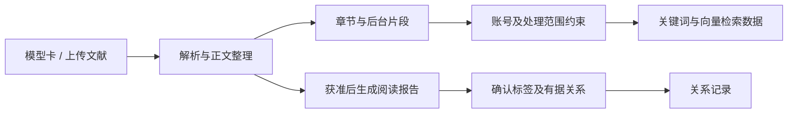
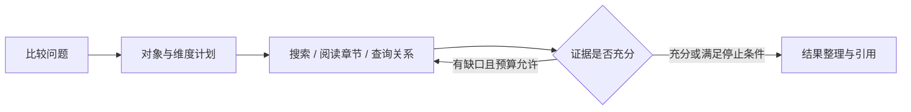

# 系统架构

前端以模型学习、文献阅读和比较研究组织用户操作；后端负责账号、资料范围、知识检索、模型请求与结果保存。基础知识与个人文献进入按账号约束的检索视图，回答依据与会话记录分别保留。

## 组件与职责

| 组件 | 职责 | 主要入口 |
| --- | --- | --- |
| Vue 前端 | 页面路由、模型阅读、文献管理、问答和研究结果展示 | [frontend/src](../model-rag/frontend/src) |
| FastAPI | 请求校验、认证、权限、SSE 与业务接口 | [backend/main.py](../model-rag/backend/main.py) |
| 账号与检索视图 | 数据归属约束、按账号装配可检索资料 | [access.py](../model-rag/backend/infra/access.py)、[secure_retriever.py](../model-rag/backend/infra/secure_retriever.py) |
| 问题规划与检索 | 对象识别、查询改写、召回、融合与关系扩展 | [backend/rag](../model-rag/backend/rag) |
| 解释与校验 | 正文组织、生成约束、引用检查与回答复核 | [backend/generation](../model-rag/backend/generation) |
| 文献处理 | 文件解析、阅读报告、版本与后台任务 | [backend/infra](../model-rag/backend/infra) |
| MySQL 与本地缓存 | 知识、文献、关系、报告、会话及向量缓存 | [database.py](../model-rag/backend/infra/database.py)、[retrieval.py](../model-rag/backend/rag/retrieval.py) |

开发时 Vue 通过同源 `/api` 代理访问本机后端。页面不直接连接数据库，也不保存模型服务密钥。

## 文献与知识入库

模型卡区分原始来源、整理说明和教学示例。上传文献保存文件与解析信息，后台片段用于检索，报告用于整篇阅读。PDF 不还原原始版式，解析定位应结合原文件使用。

向量以 NumPy 文件缓存，并按用户划分索引目录；不要求外部向量数据库。文献版本与优先级属于资料管理能力，不替代来源核验。

## 问答与检索流程

1. 校验账号及所选会话、模型和文献的访问范围。
2. 根据当前问题、页面选择和近期会话确定询问对象。
3. 生成检索查询，在当前账号视图中执行关键词、向量及实体/章节召回。
4. 合并候选、按条件重排，并为命中的子片段组织章节上下文。
5. 在适用的查证流程中核对证据缺口，使用获准工具补查。
6. 将本轮正文和必要上下文交给配置的生成服务，校验引用并保存完整回合。

查询规划先由规则确定对象。当前代码对追问、比较或关系等情况按条件调用模型改写，并校验模型 ID 和子问题范围；不是所有问题都调用模型做查询规划。嵌入、重排与答案生成是另外的服务调用，不能与规划调用混为一谈。

普通聊天的证据循环、所选文献的范围补查和比较研究按各自场景启用。选中文献时，按文献范围策略处理补查；限定只依据本文的问题保留原资料范围。

跨文献工具用明确的范围参数控制模型名筛选：问题中提到模型时仍用于召回相关内容，工具可以在获准章节内跨文献检索。指定对象、账号视图和资料授权继续限制可访问范围。普通模型阅读保留原有模型范围。

聊天补查的候选池最多保留 10 个章节，最终最多引用 5 条。候选满时，新查得正文可替换未覆盖查证项目的旧候选；最终选取优先覆盖不同子问题，并保留补查文献定位。查证项的引用按最终正文重新编号，前端展示与生成使用同一份最终核对项。

模型核对结果用于组织回答与标明缺口，不能视为正确率或事实认证。检索范围与引用覆盖的回归通过，仍需逐项核对实际回答是否受到相邻正文支持；复杂应用问题的内容质量另外评审。

会话历史用于指代和用户约束，事实依据来自本轮正文。当前生成入口按最近消息和长度窗口组织历史，供本轮问题理解使用。

## 图关系与比较研究

### 图关系

GraphRAG 使用关系记录和本地遍历。关系带有支持它的章节与摘录，扩展时核对证明是否属于可使用的正文。

关系通过数据库记录和本地遍历实现。已有边说明某种联系，因果关系和性能结论仍需相应正文支持。

### 比较研究

LangGraph 研究流程限制为最多 3 轮查找、7 次工具调用，正文范围和引用均进行校验。停止条件包括证据充分、没有新增证据、动作重复、证据不足且没有后续动作或达到预算。

这是一套受限工具和资料范围内的查证流程，不自行联网抓取任意网页。原文没有报告的性能和实验细节仍需保留缺口。

## 账号与资料处理边界

| 数据或操作 | 约束方式 |
| --- | --- |
| 预置模型卡 | 登录账号共享基础知识 |
| 个人文献、自建模型与关系 | 按所有者约束数据库读写与检索视图 |
| 分析报告与会话 | 服务端检查归属，不能只依赖前端菜单 |
| 向量缓存 | 按账号隔离缓存与资料范围 |
| 远程模型请求 | 先检查相关资料及上下文是否允许云端处理 |
| 维护接口 | 同时要求管理员角色及服务端维护白名单 |

登录使用 HttpOnly Cookie，写操作校验 CSRF。业务管理员不自动获得其他账号私有资料的访问权。具体配置见[运行说明](../model-rag/README.md#账号与资料归属)。

## 运行与验证边界

后台任务和限频状态目前位于单进程中。重启后，运行中任务需重新发起；已经保存的文献、报告和会话仍由数据库保留。

模型 API 的配置、网络和资料许可决定哪些远程能力能够执行。服务启动或接口存活，不等于模型请求已经实测可用。回归检查、检索指标和真实回答质量分别验证，具体方法见[测试说明](TESTING.md)。
