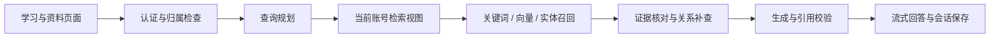

# 架构与权限

Vue页面通过同源`/api`调用FastAPI。开发代理将请求转发到本机8002端口；登录使用HttpOnly Cookie，写请求校验CSRF。数据库保存知识、资料、关系、报告和会话。

查询先结合当前模型、章节与会话确定对象，再进行多路召回、融合和重排。关系扩展使用带原文依据的边；研究流程通过LangGraph组织分解、检索、证据核对与有界补查。最终证据提供给配置的模型，回答通过SSE返回，并保存完整回合。

归属列与请求身份约束数据库读写。检索实例及向量缓存按账号区分；上传内容编号包含账号范围。预置模型卡为共享知识，个人文献、自建模型与关系、报告和会话为私有记录。维护操作同时检查管理员角色和服务端ID白名单。

运行任务与限频状态位于单进程内，尚未采用分布式任务队列；向量为本地NumPy缓存，关系通过记录和遍历实现。当前图谱不使用Neo4j或社区级摘要。论文原文件和图示为可选本地资料。
